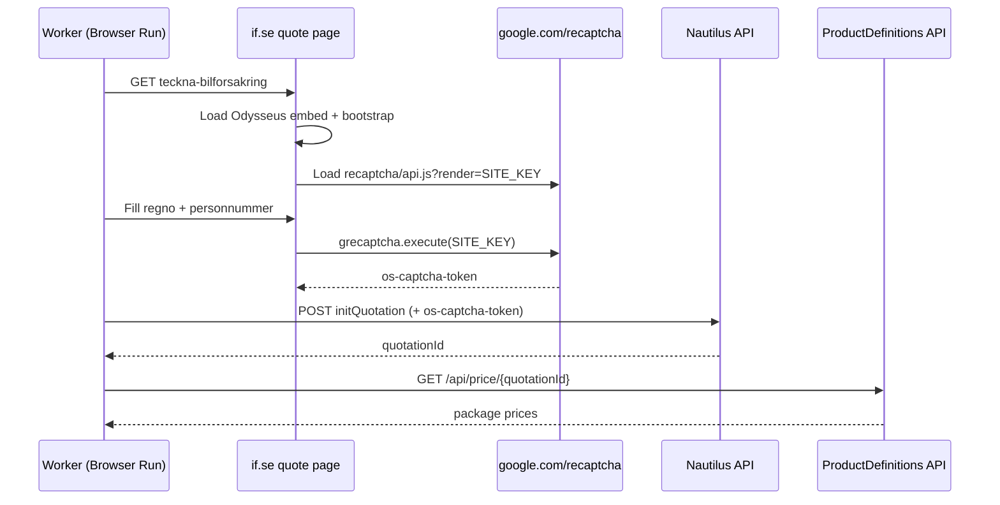

# If (if.se) — motor quote provider

Private car quotes via If's **OnlineSales / Odysseus / Nautilus** stack on `if.se`.

> **Production path:** quotes run through **Cloudflare Browser Run** (`@cloudflare/playwright`).
> Plain `fetch()` from the worker fails captcha validation. See [Captcha & Browser Run](#captcha--browser-run).

## Quote flow



### Steps (API level)

1. Generate `quotationId` and `x-cc-correlationid` (UUIDs).
2. **POST** `initQuotation` with regno, personnummer, and `os-captcha-token` header.
3. **GET** `/api/price/{quotationId}` for trafik / halv / hel prices.

Constants and URLs live in `form-config.ts`. Request/response shapes in `types.ts`.
Mapping to our `QuoteResponse` is in `mapper.ts`.

## Endpoints

| Step | Method | URL |
|------|--------|-----|
| Shop bootstrap (config only) | GET | `https://if.se/apps/waypoint/onlinesales/odysseus-web/api/shops/bootstrap?shopId={shopId}&salesChannelId={channelId}&partnerId=null` |
| Embed loader | GET | `https://if.se/apps/waypoint/onlinesales/odysseus-web/api/embed/bundle?shopId=...&salesChannelId=...` |
| Init quotation | POST | `https://if.se/apps/waypoint/onlinesales/odysseus-web/api/nautilus/initQuotation?businessArea=private&legalUnit=SE&culture=sv-SE&salesChannelId=...&definition=PrivateCar&shopId=...&quotationId={uuid}` |
| Price | GET | `https://if.se/apps/waypoint/onlinesales/productdefinitions-api/api/price/{quotationId}` |

Required headers for `initQuotation`:

- `os-captcha-token` — reCAPTCHA v3 token (see below)
- `x-cc-correlationid` — UUID
- `origin: https://www.if.se`
- `referer: https://www.if.se/`

### initQuotation body (minimal)

```json
{
  "inputs": [
    {
      "id": 30020569,
      "value": "LZB794",
      "metadata": { "validated": true, "tags": ["IdentifiesInsuredObject"] }
    },
    {
      "id": 30020611,
      "value": "19720325-7097",
      "metadata": { "validated": true, "tags": [] }
    }
  ],
  "products": [],
  "periodStart": "2026-05-23T12:00:00.000Z",
  "legalNumber": "19720325-7097",
  "salesContext": "MotorNewsales"
}
```

Personnummer must be `YYYYMMDD-XXXX` — use `formatIfPersonnummer()`.

## Captcha & Browser Run

If protects `initQuotation` with **Google reCAPTCHA v3**. The token is sent as
`os-captcha-token`. If also validates the **reCAPTCHA score server-side**.

### What does *not* return a captcha token

These requests appear in DevTools on the product page but **do not** mint or return
`os-captcha-token`:

| Request | Purpose |
|---------|---------|
| `toggles` | IF GPT feature flags |
| `bootstrap` / `api/shops/bootstrap` | Shop config, form field defs, feature toggles (`EnableReCaptchaForMulti`, etc.) |
| `initiate?pageUrl=...` (ifhelp.if.eu) | Puzzel chat widget |
| `loginstate` / `getUserInfo` | Auth checks |
| `visitor` / `collect` / `track` | Analytics |
| `ai.config` | Application Insights |

The token is created by **`grecaptcha.execute()` in the browser**, after Odysseus loads:

```
https://www.google.com/recaptcha/api.js?onload=Odysseus_onReCaptchaLoad&render=6LcH85gsAAAAAM8VABLSexJcdIgRNCYgnmVFg25q
```

Site key: `IF_RECAPTCHA_SITE_KEY` in `form-config.ts`.

Odysseus calls `grecaptcha.execute(siteKey, { action: "odysseus" })` — not `"submit"`.
Browser Run may intermittently get `ReCaptchaScoreIndicatesBot` (714); the worker retries up to 3 times with page warmup delays.

### Why plain fetch fails

| Approach | Typical result |
|----------|----------------|
| No `os-captcha-token` | `400 CaptchaTokenMissing` |
| Token from curl / injected script outside page session | `400 ReCaptchaScoreIndicatesBot` (code `714`) |
| Token + `initQuotation` via **same-origin `fetch()` inside loaded quote page** | `200` ✓ |

Because we run on **Cloudflare Workers**, the working approach is
[Browser Run + Playwright](https://developers.cloudflare.com/browser-rendering/platform/playwright/):

- Implementation: `apps/bilforsakringar/worker/src/if-browser-quote.ts`
- Wrangler: `[browser] binding = "BROWSER"` + `nodejs_compat`
- Worker skips `IfProvider.getQuote()` and calls `fetchIfQuoteViaBrowser()` when `env.BROWSER` is set

Browser Run flow:

1. Open `IF_QUOTE_PAGE_URL` (`/teckna-bilforsakring` — **not** the main product page).
2. Accept cookie banner (`#onetrust-accept-btn-handler`).
3. Fill regno (`placeholder="ABC123"`) and personnummer (`placeholder="ååååmmddnnnn"`, no dash).
4. Wait for Odysseus to load `grecaptcha`.
5. Run `initQuotation` + price `fetch` inside `page.evaluate()` (same origin as if.se).

### Fallback: manual captchaToken

`QuoteRequest.captchaToken` is optional. `client.ts` / `IfProvider` use it when set.
Useful for local experiments; production should rely on Browser Run.

## Product mapping

| IF product ID | Our type | Name |
|---------------|----------|------|
| `30000155` | `trafik` | Trafikförsäkring |
| `30000156` | `halv` | Halvförsäkring |
| `30000158` | `hel` | Helförsäkring |

Input IDs: `30020569` (regno), `30020611` (personnummer), `40000034` (annual mileage).

## File layout

```
if/
├── README.md          ← this file
├── form-config.ts     ← shop IDs, reCAPTCHA site key, quote page URL, personnummer format
├── types.ts           ← Zod schemas for init + price responses
├── client.ts          ← fetch-based initQuotation + price (requires captchaToken)
├── mapper.ts          ← IfPriceResponse → QuoteResponse
└── index.ts           ← IfProvider (registry entry)
```

Worker-side browser implementation (not in this folder):

```
apps/bilforsakringar/worker/src/if-browser-quote.ts
```

## Common errors

| Error | Meaning |
|-------|---------|
| `CaptchaTokenMissing` | No `os-captcha-token` header |
| `ReCaptchaScoreIndicatesBot` (714) | Token rejected — must mint inside real page context |
| `Policy deny` | WAF / malformed request (check JSON body) |
| `no grecaptcha` | Quote widget did not load; wrong page or bot blocked |

## Local debugging

1. Open `https://www.if.se/privat/forsakringar/bilforsakring/teckna-bilforsakring` in DevTools.
2. Filter Network: `recaptcha`, `initQuotation`, `bootstrap`.
3. Confirm `api/shops/bootstrap` returns 200 and recaptcha script loads after filling inputs.
4. For Browser Run locally: `X_BROWSER_HEADFUL=true bun run worker:dev` (see CF docs).

## References

- [Cloudflare Browser Run — Playwright](https://developers.cloudflare.com/browser-rendering/platform/playwright/)
- If platform: OnlineSales / Odysseus / Nautilus (Waypoint)
- Shop: `PrivateCar`, sales context `MotorNewsales`, legal unit `SE`

## Deploy

Worker requires Browser Run on the Cloudflare account (Workers Paid).

```bash
# wrangler.toml must include:
#   compatibility_flags = ["nodejs_compat"]
#   compatibility_date = "2026-05-23"
#   [browser] binding = "BROWSER"

cd apps/bilforsakringar
bun run deploy          # pages + worker
# or worker only:
bun run worker:deploy
```

Production entry point: `apps/bilforsakringar/worker/src/if-browser-quote.ts`  
All quote routes (`/quote`, `/quote/start`, `/quote/stream`, `/quote/if`) use Browser Run for IF when `env.BROWSER` is bound.
